# TP13 : Cloud AWS local avec Floci et Terraform avancé

Projet complet du TP13. Suivez les étapes dans l'ordre : chaque 📸 indique une capture à enregistrer dans `captures/`.
Les réponses aux questions du TP sont dans [REPONSES.md](REPONSES.md).

```
.
├── captures/                  ← vos 8 captures .png
├── compose.yaml               ← Floci + sdk-demo (Partie 2)
├── lambda/index.mjs           ← fonction Lambda
├── sdk-demo/                  ← programme SDK JavaScript v3 (TODO SQS complété)
├── scripts/
│   ├── partie1-cli.sh         ← toutes les commandes AWS CLI de la Partie 1
│   ├── bootstrap-backend.sh   ← bucket tp13-tfstate (Partie 4)
│   └── scan-iac.sh            ← Checkov + Trivy, code retour bloquant (Partie 5)
├── terraform/
│   ├── providers.tf  variables.tf  main.tf  buckets.tf  outputs.tf
│   ├── dev.tfvars  staging.tfvars  prod.tfvars
│   ├── backend.tf.example
│   ├── modules/secure-bucket/
│   └── etapes/                ← fichiers à copier au fil du TP
├── ci/                        ← Jenkinsfile (TP9) et workflow GitHub (TP10)
└── terragrunt/                ← défi Terragrunt
```

## 0. Préparation

```bash
# AWS CLI v2
curl -sSL "https://awscli.amazonaws.com/awscli-exe-linux-x86_64.zip" -o awscliv2.zip
unzip -q awscliv2.zip && sudo ./aws/install && aws --version
sudo apt install -y zip unzip

# Floci
docker run -d --name floci -p 4566:4566 \
  -v /var/run/docker.sock:/var/run/docker.sock floci/floci
docker logs floci
```

## 1. Partie 1 : AWS CLI

```bash
chmod +x scripts/*.sh
./scripts/partie1-cli.sh
export AWS_PROFILE=floci
export QURL=$(aws sqs get-queue-url --queue-name tp13-demo --query QueueUrl --output text)
```

📸 **floci-cli.png** : sortie S3, SQS, DynamoDB (`scan`) et `lambda invoke` (contenu de `out.json`).

## 2. Partie 2 : SDK JavaScript

```bash
cd sdk-demo && npm install
npm start                      # écrit et liste des objets dans tp13-demo
QUEUE_URL=$QURL npm start      # + envoie un message JSON dans la file
aws sqs receive-message --queue-url "$QURL"
cd ..
```

📸 **sdk-demo.png** : objets listés + "Message SQS envoyé" + `receive-message`.

Version Compose (question sur `AWS_ENDPOINT_URL` : voir REPONSES.md) :

```bash
docker rm -f floci             # libère le port 4566
docker compose up --build sdk-demo
docker compose down
docker run -d --name floci -p 4566:4566 -v /var/run/docker.sock:/var/run/docker.sock floci/floci
```

> Floci repart vide après redémarrage : relancez `./scripts/partie1-cli.sh` si vous avez encore besoin de `tp13-demo`.

## 3. Partie 3 : Terraform avec le provider AWS

`buckets.tf` contient au départ la version "à plat" du bucket (`etapes/buckets-partie3.tf.example`).

```bash
cd terraform
export AWS_PROFILE=floci
export TF_VAR_api_key='sk-dev-change-me'   # secret : jamais dans un .tfvars

terraform init && terraform fmt && terraform validate
terraform plan -out tfplan
terraform apply tfplan
terraform output
aws s3api get-bucket-versioning --bucket tp13-uploads-dev
aws sqs list-queues && aws dynamodb list-tables
```

📸 **terraform-apply.png** : fin de l'apply + vérifications AWS CLI.

Dérive (drift) :

```bash
aws dynamodb delete-table --table-name tp13-visits-dev
terraform plan
```

📸 **drift.png** : le plan propose de recréer `aws_dynamodb_table.visits`. Ensuite, `terraform apply` pour revenir à l'état voulu.

## 4. Partie 4 : Modules, environnements, state distant

### 4.1 Passage au module

```bash
cp etapes/buckets-partie4.tf.example buckets.tf
terraform init                 # enregistre le module
terraform plan                 # "has moved to module.uploads…" : 0 to destroy
terraform apply                # crée seulement le bucket backups
```

Les blocs `moved` font le travail. Sans eux, l'équivalent manuel serait :

```bash
terraform state mv aws_s3_bucket.uploads module.uploads.aws_s3_bucket.this
terraform state mv aws_s3_bucket_versioning.uploads module.uploads.aws_s3_bucket_versioning.this
terraform state mv aws_s3_bucket_public_access_block.uploads module.uploads.aws_s3_bucket_public_access_block.this
terraform state mv aws_s3_bucket_server_side_encryption_configuration.uploads module.uploads.aws_s3_bucket_server_side_encryption_configuration.this
```

La validation de `var.environment` se teste avec `terraform plan -var environment=qa` (erreur attendue).

### 4.2 Backend S3 verrouillé

```bash
../scripts/bootstrap-backend.sh
mv backend.tf.example backend.tf
terraform init -migrate-state      # répondre "yes"
aws s3 ls s3://tp13-tfstate/envs/dev/
```

📸 **remote-state.png** : `terraform.tfstate` visible dans `envs/dev/`.

Test du verrou :

```bash
# Terminal 1
terraform apply -var-file=dev.tfvars    # NE PAS répondre à la confirmation
# Terminal 2 (même dossier, export AWS_PROFILE=floci et TF_VAR_api_key)
terraform plan -var-file=dev.tfvars
```

📸 **state-lock.png** : `Error acquiring the state lock`. Répondre ensuite `no` dans le terminal 1.

> Si le verrou ne se déclenche pas (Floci sans écritures conditionnelles S3), passez en DynamoDB :
> créez la table (commande dans `etapes/backend-dynamodb.tf.example`), puis
> `cp etapes/backend-dynamodb.tf.example backend.tf && terraform init -reconfigure`, et notez-le dans le rendu.

### 4.3 Un state par environnement

```bash
terraform init -reconfigure -backend-config="key=envs/prod/terraform.tfstate"
terraform apply -var-file=prod.tfvars
aws s3 ls s3://tp13-tfstate/envs/ --recursive
terraform init -reconfigure -backend-config="key=envs/dev/terraform.tfstate"   # retour en dev
```

Alternative avec les workspaces : `terraform workspace new staging && terraform apply -var-file=staging.tfvars`
(state rangé sous `env:/staging/envs/dev/terraform.tfstate`). Comparaison dans REPONSES.md.

## 5. Partie 5 : Scan IaC et OpenTofu

```bash
cd ..                               # racine du projet
./scripts/scan-iac.sh               # doit être OK (exceptions justifiées par #checkov:skip)
cp terraform/etapes/mauvaise-config.tf.example terraform/mauvaise-config.tf
./scripts/scan-iac.sh; echo "code retour = $?"   # ÉCHEC, code 1
rm terraform/mauvaise-config.tf
```

📸 **iac-scan.png** : Checkov/Trivy listant `CKV_AWS_53`… sur `aws_s3_bucket_public_access_block.insecure`.

CI : ajouter le stage de `ci/Jenkinsfile` au Jenkinsfile du TP9, **ou** copier `ci/iac-scan.yml` dans `.github/workflows/` (TP10).

OpenTofu sur une copie du projet :

```bash
curl -fsSL https://get.opentofu.org/install-opentofu.sh -o install-opentofu.sh
chmod +x install-opentofu.sh && ./install-opentofu.sh --install-method deb && rm install-opentofu.sh
tofu version

cp -r terraform /tmp/tp13-tofu && cd /tmp/tp13-tofu
rm -rf .terraform .terraform.lock.hcl backend.tf terraform.tfstate*
sed -i 's/tp13-/tp13tofu-/g' buckets.tf main.tf   # noms différents pour ne pas entrer en conflit
tofu init && tofu plan && tofu apply
tofu destroy && cd -
```

📸 **opentofu.png** : `Apply complete!` de `tofu apply`.

## 6. Défis (facultatifs)

* **Lambda + SQS** : `cp terraform/etapes/defi-lambda.tf.example terraform/defi-lambda.tf`, `terraform init -upgrade && terraform apply -var-file=dev.tfvars`, puis envoyer un message dans la file et lire `docker logs floci`.
* **Terragrunt** : `cd terragrunt/dev && terragrunt plan` (nécessite `buckets.tf` en version modules et `TF_VAR_api_key`).

## 7. Nettoyage

```bash
cd terraform
terraform destroy -var-file=dev.tfvars
docker rm -f floci
```

## Rendu

* `captures/*.png` (8 fichiers)
* `terraform/` : `*.tf`, `.terraform.lock.hcl` (créé par `terraform init`), `*.tfvars` (sans secret)
* `REPONSES.md` (dont la comparaison Floci / LocalStack / AWS)
* **Jamais** `terraform.tfstate`, `tfplan` ni `.terraform/` (déjà dans `.gitignore`)

## Captures

### Partie 1 : AWS CLI contre Floci
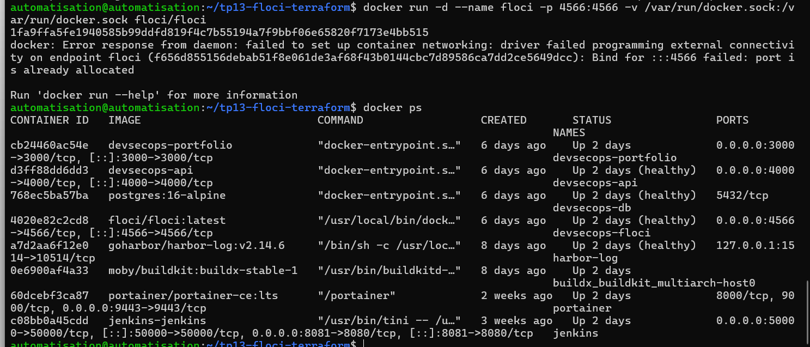
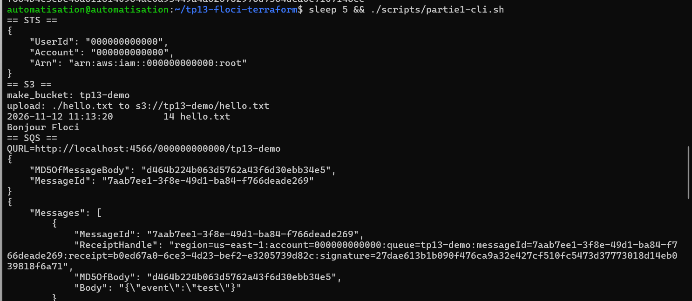
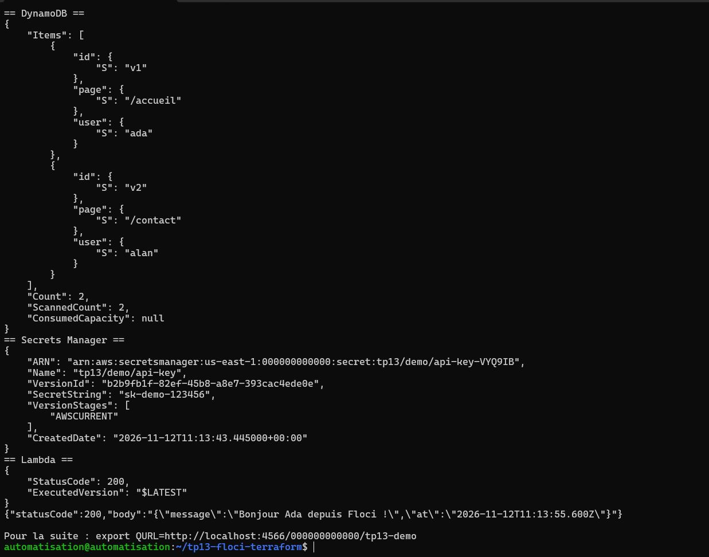

### Partie 2 : SDK JavaScript
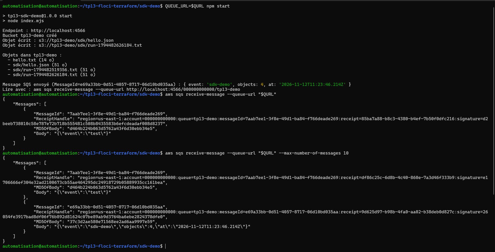

### Partie 3 : Terraform avec le provider AWS
**terraform apply et vérification AWS CLI**
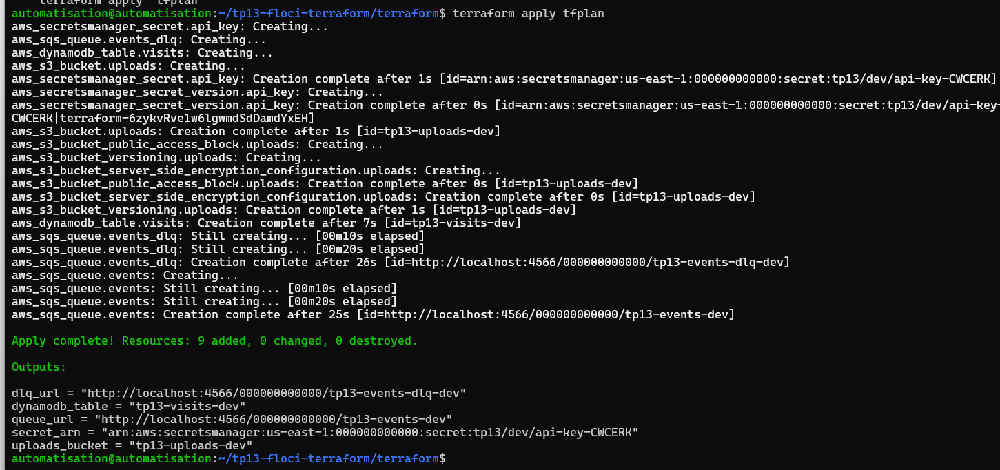

**Dérive (drift) : terraform plan après suppression manuelle de la table**
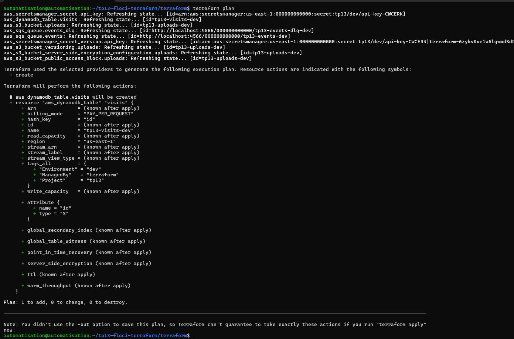

### Partie 4 : State distant et verrou
**State dans s3://tp13-tfstate/envs/dev/**
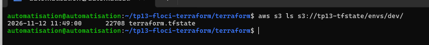

**Verrou : Error acquiring the state lock**
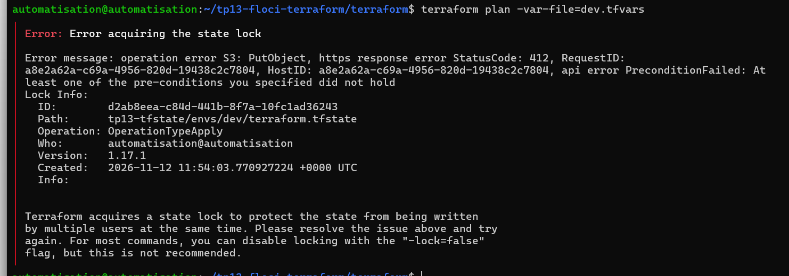
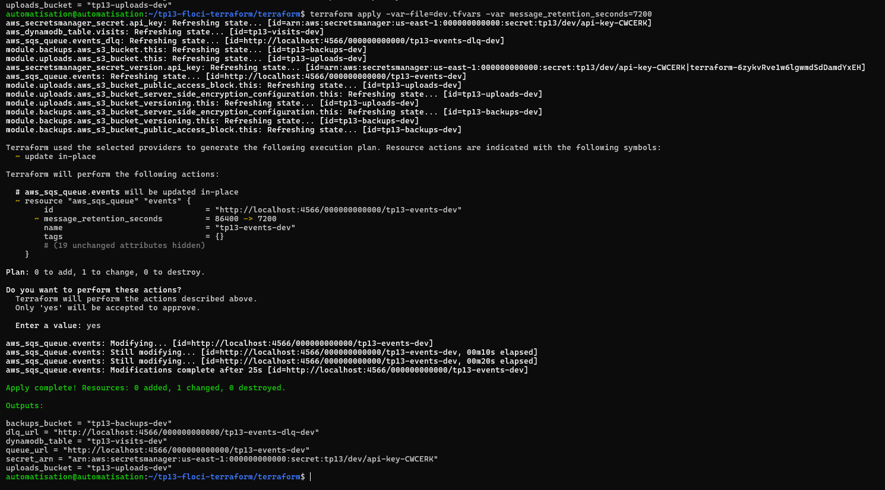

### Partie 5 : Scan IaC et OpenTofu
**Checkov / Trivy détectent la mauvaise configuration**
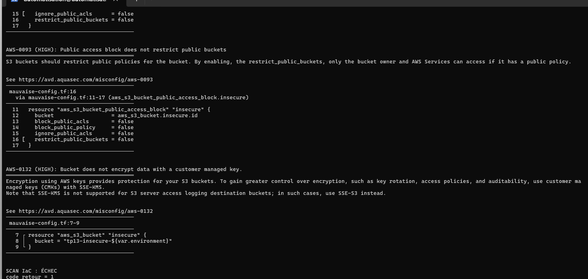

**tofu apply réussi**
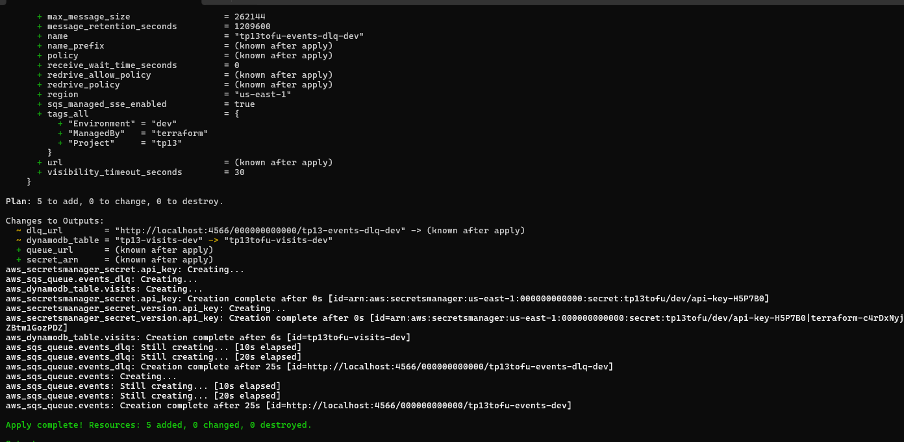
